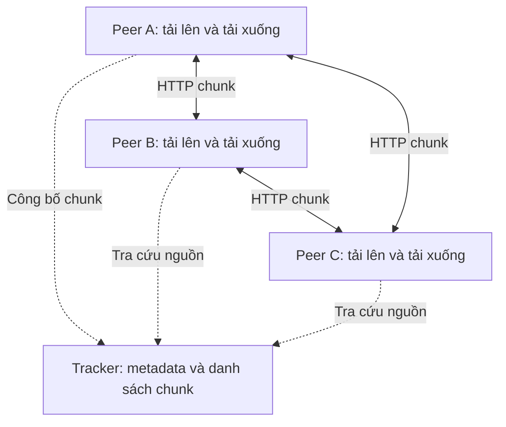

# DS02 — Mô phỏng chia sẻ file P2P theo nguyên lý BitTorrent

Dự án gồm **một tracker và ba peer A, B, C chạy thành các tiến trình độc lập**. File được chia thành các chunk, truyền trực tiếp giữa các peer qua HTTP và kiểm tra SHA-256. Một peer có thể chia sẻ chunk đã nhận ngay khi vẫn đang tải phần còn lại.

Giao diện trình duyệt cho phép chọn PDF, DOCX hoặc file khác từ máy, quan sát từng chunk di chuyển và chạy bốn tình huống demo. Công nghệ sử dụng: Python, FastAPI, aiohttp, asyncio; Docker Compose là lựa chọn bổ sung.

## 1. Tải dự án và chuẩn bị

- Cài **Python 3.11 trở lên** để dùng bộ thư viện cố định bên dưới; có thể dùng Python 3.12. Bản hiện tại đã được kiểm tra trên Windows với Python 3.14.4.
- Chuẩn bị kết nối Internet khi cài các thư viện lần đầu.
- Trên trang GitHub của dự án, chọn **Code → Download ZIP** rồi giải nén, hoặc dùng Git để clone bằng URL HTTPS ở nút **Code**.
- Mở thư mục có **`pyproject.toml`, `src/`, `scripts/`** trong VS Code, rồi mở **Terminal → New Terminal**. Các lệnh bên dưới đều chạy tại thư mục này.

Demo trình duyệt chạy trực tiếp bằng Python, không cần Docker hay tạo file `.env`.

## 2. Cài đặt và mở giao diện

### Windows 10/11 — PowerShell

```powershell
py -3 --version
py -3 -m venv .venv
.\.venv\Scripts\python.exe -m pip install -c constraints-demo.txt -e ".[dev]"
.\.venv\Scripts\python.exe scripts/run_visual.py
```

Nếu máy nhận lệnh `python` thay cho `py`, dùng `python --version` và `python -m venv .venv` ở hai dòng đầu. Kiểm tra phiên bản hiển thị từ 3.11 trở lên. Các lệnh sau gọi trực tiếp Python trong `.venv`, không cần chạy `Activate.ps1`.

### macOS / Linux — Terminal

```bash
python3 --version
python3 -m venv .venv
./.venv/bin/python -m pip install -c constraints-demo.txt -e ".[dev]"
./.venv/bin/python scripts/run_visual.py
```

Mở **[http://127.0.0.1:8080](http://127.0.0.1:8080)** bằng Chrome, Edge, Firefox hoặc trình duyệt khác. Giữ Terminal đang chạy trong lúc sử dụng giao diện.

File [constraints-demo.txt](constraints-demo.txt) cố định phiên bản các thư viện của môi trường demo đã kiểm tra, giúp các máy dùng cùng bộ phiên bản khi cài đặt. Bộ phiên bản này cần Python 3.11 trở lên.

Những lần chạy sau chỉ cần mở lại Terminal trong thư mục dự án và chạy dòng `scripts/run_visual.py` bằng Python của `.venv` như trên.

## 3. Chọn file và chạy bốn demo

1. Bấm **Chọn file** và chọn PDF, DOC, DOCX hoặc định dạng bất kỳ, kích thước **8 byte đến 32 MiB**. Chờ giao diện hiển thị đúng tên và kích thước. Có thể bấm **Dùng file mẫu** để dùng file 4 MiB được tạo tự động.
2. Chọn một demo rồi bấm **Chạy demo**, hoặc bấm **Chạy cả 4 demo**.
3. Quan sát kho chunk của A/B/C, hướng truyền, nhật ký và các điều kiện kiểm chứng. Màu chunk cho biết nguồn đã cung cấp; chunk bị phát hiện hỏng được đánh dấu đỏ.
4. Khi hoàn tất và hash được xác minh, tải file kết quả của B về máy. PDF/DOCX giữ nguyên định dạng và có thể mở bằng ứng dụng tương ứng.

| Demo | Diễn biến | Minh chứng cần thấy |
|---|---|---|
| **1. B tải từ A và C** | C tải bản sao từ A trong pha chuẩn bị; B tải song song từ A/C | Sự kiện nhận chunk của B có cả nguồn A và C |
| **2. B chưa tải xong đã chia sẻ cho C** | B bắt đầu tải từ A; C tham gia khi B mới có một phần file | B có `UPLOAD` với `completed=false`; C nhận chunk từ B |
| **3. Phát hiện chunk hỏng và tải lại** | C cố ý giữ chunk #1 sai; B kiểm tra hash và lấy bản thay thế từ A | B có `INVALID_CHUNK` từ C rồi `DOWNLOAD_CHUNK` từ A cho **cùng chunk #1** |
| **4. A ngừng cấp dữ liệu, B chuyển sang C** | A ngừng phục vụ giữa lượt tải và trả HTTP 503 | B thử lại chunk bị gián đoạn từ C, hoàn tất file đúng hash |

Demo 4 mô phỏng ngừng phục vụ dữ liệu: **tiến trình A vẫn chạy** và được bật phục vụ lại sau demo. Phần Docker bên dưới có hướng dẫn dừng hẳn peer để trình bày thêm.

Mỗi demo khởi tạo tracker và ba peer trên các cổng loopback riêng, với thư mục dữ liệu mới cho từng peer. **Chỉ A được cấp file gốc; B và C nhận chunk qua mạng.** Tracker giữ metadata và danh sách chunk, không lưu hoặc chuyển tiếp nội dung file. Dashboard điều khiển và quan sát các lượt truyền thực tế.

File được giữ nguyên tên và toàn bộ byte, không chèn dữ liệu hay chuyển định dạng. Kích thước chunk tự điều chỉnh để có tối đa 64 chunk; giới hạn tối thiểu 8 byte bảo đảm có đủ chunk cho các tình huống chia sẻ và chuyển nguồn. Tên file chứa đường dẫn, ký tự điều khiển hoặc tên dành riêng của Windows bị từ chối.

File đã chọn được dùng cho các demo tiếp theo trong cùng phiên, kể cả khi tải lại trang. Đổi file hoặc bấm **Dùng file mẫu** để thay nguồn; khởi động lại dashboard sẽ trở về file mẫu. Xem [kịch bản thuyết trình chi tiết](docs/DEMO_VISUAL.md).

## 4. Dừng demo, lấy file và xem log

Nhấn **Ctrl+C trong Terminal** để tắt dashboard và các tiến trình do nó tạo. Chạy xong demo không tự đóng dashboard, nên có thể xem kết quả hoặc chọn demo khác.

| Đường dẫn | Nội dung |
|---|---|
| `runtime/visual-<thời gian>-<mã>/peer-b/downloads/` | File hoàn chỉnh của B, giữ tên gốc |
| `runtime/visual-<thời gian>-<mã>/peer-c/downloads/` | File của C sau khi C tải xong |
| `runtime/visual-<thời gian>-<mã>/tracker.log` | Log tracker |
| `runtime/visual-<thời gian>-<mã>/peer-a.log`, `peer-b.log`, `peer-c.log` | Log từng peer |
| `runtime/visual-inputs/` | Bản nguồn đã chọn, được cấp riêng cho A trong mỗi demo |

Dashboard hiển thị đường dẫn file kết quả và SHA-256. Thư mục `runtime/` được giữ lại khi dừng chương trình và được loại khỏi Git. Người khác tải mã nguồn sẽ tạo dữ liệu mới trên máy của họ.

## 5. Chạy kiểm chứng từ Terminal

Các kiểm thử mạng khởi chạy các tiến trình riêng và trao đổi qua TCP/HTTP. Không cần Docker cho các lệnh này.

**Windows:**

```powershell
.\.venv\Scripts\python.exe -m pytest -q
.\.venv\Scripts\python.exe scripts/run_visual.py --check
.\.venv\Scripts\python.exe scripts/run_visual.py --check --file "docs\input_specification.pdf"
```

**macOS / Linux:**

```bash
./.venv/bin/python -m pytest -q
./.venv/bin/python scripts/run_visual.py --check
./.venv/bin/python scripts/run_visual.py --check --file "docs/input_specification.pdf"
```

`--check` chạy cả bốn tình huống bằng cùng controller của dashboard, kiểm tra sự kiện và hash đầu ra rồi thoát. `--file` chọn nguồn riêng cho chế độ này; khi dùng giao diện, chọn file bằng nút **Chọn file**.

Để chạy bốn kịch bản terminal ban đầu, dùng `scripts/run_local.py` với Python của `.venv`. Script này cần các cổng **8000, 9001, 9002, 9003** còn trống, tự khởi chạy bốn tiến trình, chạy kiểm chứng rồi dừng và để lại log trong `runtime/local-*/`.

Bản ZIP đã được giải nén vào thư mục mới, cài bằng môi trường Python riêng và đạt **50 bài kiểm thử** trên Windows ngày **19/10/2026**. Bốn kịch bản terminal và bốn kịch bản visual với PDF thật đều thành công; giao diện, JavaScript, CSS và API trạng thái tải đúng từ bản giải nén. Kiểm tra trình duyệt trước đó cũng xác nhận DOCX giữ nguyên tên, byte sau khi tải qua B. Chi tiết phạm vi và kết quả nằm trong [kế hoạch kiểm thử](docs/TEST_PLAN.md).

## 6. Xử lý lỗi thường gặp

| Hiện tượng | Cách xử lý |
|---|---|
| Không nhận `py`/`python`, hoặc mở Microsoft Store | Cài Python, mở lại Terminal; kiểm tra phiên bản rồi tạo `.venv` |
| Báo không có `venv` trên Linux | Cài thành phần `venv` của bản Python đang dùng rồi tạo lại môi trường |
| Thiếu `fastapi`, `aiohttp`, `p2psim` hoặc thư viện khác | Chạy lại dòng `-m pip install -c constraints-demo.txt -e ".[dev]"` bằng đúng Python của `.venv` trong thư mục có `pyproject.toml` |
| Không thấy `scripts/run_visual.py` | Terminal đang sai thư mục; chuyển đến thư mục chứa `pyproject.toml` |
| Cổng 8080 đang được dùng | Thêm `--port 8081` vào lệnh mở dashboard, rồi vào `http://127.0.0.1:8081` |
| Trang không kết nối được | Kiểm tra Terminal còn chạy và mở đúng địa chỉ/cổng vừa in ra |
| Chọn file bị từ chối | Kiểm tra kích thước 8 byte–32 MiB và tên file; có thể thử **Dùng file mẫu** |
| Demo báo lỗi | Xem thông báo và log trong thư mục `runtime/visual-*/` của lượt đó; chạy lại để tạo bộ peer mới |

## 7. Kiến trúc và cách đọc mã nguồn



- **Định danh:** Peer ID riêng cho mỗi nút; File ID là SHA-256 toàn file. Metadata chứa tên, kích thước, số chunk, hash từng chunk và hash file.
- **Khám phá:** tracker nhận công bố chunk và heartbeat; lease mặc định 12 giây loại nguồn im lặng khỏi danh sách trực tuyến.
- **Truyền dữ liệu:** `GET /api/chunks/{file_id}/{index}` giữa các peer; 1–16 worker bất đồng bộ, timeout và số lần thử lại có giới hạn.
- **Tính đúng:** kiểm tra độ dài và SHA-256 trước khi lưu chunk, ghép theo thứ tự index, kiểm tra hash toàn file trước khi đổi tên nguyên tử.
- **Phục hồi:** đổi nguồn khi timeout/503/sai hash; lưu checkpoint, kiểm tra lại chunk khi peer khởi động và tiếp tục phần thiếu khi gọi download lại với cùng File ID.
- **Đồng thời:** worker xử lý các index riêng; khóa bảo vệ cập nhật trạng thái, metadata bất biến theo File ID và thông báo chunk nhất quán dần qua tracker.
- **Truy cập:** token riêng cho tracker, truyền chunk và quản trị. Dashboard tạo token cho từng bộ tiến trình và giữ token ở backend.

| File/thư mục | Nên đọc để hiểu |
|---|---|
| [src/p2psim/common.py](src/p2psim/common.py) | Metadata, hash, kiểm tra đầu vào, ghi file nguyên tử |
| [src/p2psim/tracker.py](src/p2psim/tracker.py) | Đăng ký peer, công bố chunk, khám phá và lease |
| [src/p2psim/peer.py](src/p2psim/peer.py) | Seed, upload/download đồng thời, retry, checkpoint |
| [src/p2psim/visual.py](src/p2psim/visual.py) | Chọn file, quản lý tiến trình, bốn demo và kiểm chứng |
| [src/p2psim/visual_assets/](src/p2psim/visual_assets/) | Giao diện HTML/CSS/JavaScript |
| [src/p2psim/cli.py](src/p2psim/cli.py) | Điều khiển peer từ dòng lệnh |
| [scripts/](scripts/) | Chạy demo, tạo file mẫu và đo hiệu năng |
| [tests/](tests/) | Kiểm thử unit, API, mạng thật, lỗi và bảo mật |
| [docs/ARCHITECTURE.md](docs/ARCHITECTURE.md) | Giao thức, trạng thái và mô hình lỗi |
| [docs/REPORT.md](docs/REPORT.md) | Báo cáo kỹ thuật tiếng Việt |

## 8. Docker và CLI — tùy chọn

Docker Compose chạy tracker và ba peer trong **bốn container** để thử API/CLI. Lệnh này không mở dashboard ở cổng 8080; dùng mục 2 để có giao diện trực quan.

Sau khi cài Docker và môi trường Python ở trên, chạy trong PowerShell:

```powershell
Copy-Item .env.example .env
.\.venv\Scripts\python.exe scripts/make_sample.py
docker compose up -d --build
.\.venv\Scripts\python.exe scripts/demo.py
docker compose logs --tail=100 tracker peer-a peer-b peer-c
```

Trên macOS/Linux, dùng `cp .env.example .env` và thay `.\.venv\Scripts\python.exe` bằng `./.venv/bin/python`.

Các cổng Docker: tracker `8000`, A `9001`, B `9002`, C `9003`. API docs của A ở `http://localhost:9001/docs`. API quản trị yêu cầu `X-Admin-Token`; giá trị mẫu nằm trong `.env.example`. Nếu thay `ADMIN_TOKEN` trong `.env`, đặt cùng giá trị cho biến môi trường `ADMIN_TOKEN` ở Terminal chạy demo/CLI. File `.env` không đưa vào Git.

Ví dụ điều khiển thủ công bằng PowerShell, sau khi các container đã chạy:

```powershell
.\.venv\Scripts\python.exe -m p2psim.cli --peer http://localhost:9001 seed sample.bin
.\.venv\Scripts\python.exe -m p2psim.cli tracker-files
# Thay FILE_ID bằng file_id từ lệnh seed:
.\.venv\Scripts\python.exe -m p2psim.cli --peer http://localhost:9003 download FILE_ID
.\.venv\Scripts\python.exe -m p2psim.cli --peer http://localhost:9003 status FILE_ID
.\.venv\Scripts\python.exe -m p2psim.cli --peer http://localhost:9002 download FILE_ID
.\.venv\Scripts\python.exe -m p2psim.cli --peer http://localhost:9002 status FILE_ID
```

Chờ C tải xong trước khi cho B tải để B có hai nguồn A/C. File kết quả ở `runtime/peer-b/downloads/` và `runtime/peer-c/downloads/`. Chỉ A mount thư mục file gốc `sample_files/`.

Có thể chạy `docker compose stop peer-a` khi B đang tải và C đã có file để minh họa dừng hẳn tiến trình; bật lại bằng `docker compose start peer-a`. Thử resume bằng cách dừng/khởi động lại B rồi gọi download lại cùng File ID: các chunk hợp lệ được khôi phục, chỉ tải phần còn thiếu. Trạng thái Docker được giữ lại có chủ ý; muốn dọn dữ liệu peer để chạy mới, dừng các dịch vụ trước.

Dừng Docker bằng `docker compose down`. Thí nghiệm hiệu năng tùy chọn nằm ở `scripts/performance.py`; đọc [kế hoạch kiểm thử](docs/TEST_PLAN.md) để giữ nguồn/chunk nhất quán giữa các lần đo.

## 9. Đóng gói mã nguồn để gửi bạn bè

**Windows:**

```powershell
.\.venv\Scripts\python.exe scripts/package_source.py
```

**macOS / Linux:**

```bash
./.venv/bin/python scripts/package_source.py
```

Kết quả là `dist/DS02-P2P-BitTorrent-source.zip` và file kiểm tra `dist/DS02-P2P-BitTorrent-source.zip.sha256`. Bên trong ZIP có mã nguồn, giao diện, test, tài liệu Markdown, file đề môn học và danh sách SHA-256 của các file nguồn. Người nhận giải nén rồi làm từ mục 1–2 để chạy cùng giao diện trên máy của họ.

Gói nguồn loại bỏ `.env`, môi trường `.venv`, dữ liệu `runtime/`, file người dùng đã chọn và các file sinh ra khi demo. Báo cáo hiện hành là [docs/REPORT.md](docs/REPORT.md); bản PDF báo cáo sinh sẵn được bỏ khỏi gói để tránh dùng nội dung cũ.

## Phạm vi của dự án

Đây là mô hình phục vụ học tập, mô phỏng nguyên lý BitTorrent. Dự án chưa triển khai giao thức BitTorrent thực, DHT, magnet link, rarest-first, choking, NAT traversal, TLS hoặc định danh mật mã riêng cho từng peer. Tracker lưu trạng thái trong RAM và là một điểm lỗi đơn; peer đang chạy cần công bố lại sau khi tracker khởi động lại. Hai file cùng tên trên cùng peer có thể ghi đè file tải hoàn chỉnh trước đó.

Dashboard giới hạn file 32 MiB để demo; API peer có giới hạn riêng tối đa 1 GiB/file, 4 MiB/chunk và kiểm soát kích thước phản hồi. Token chung và HTTP hiện tại phù hợp môi trường demo được kiểm soát. Xem [báo cáo](docs/REPORT.md) để biết giới hạn và hướng phát triển.
