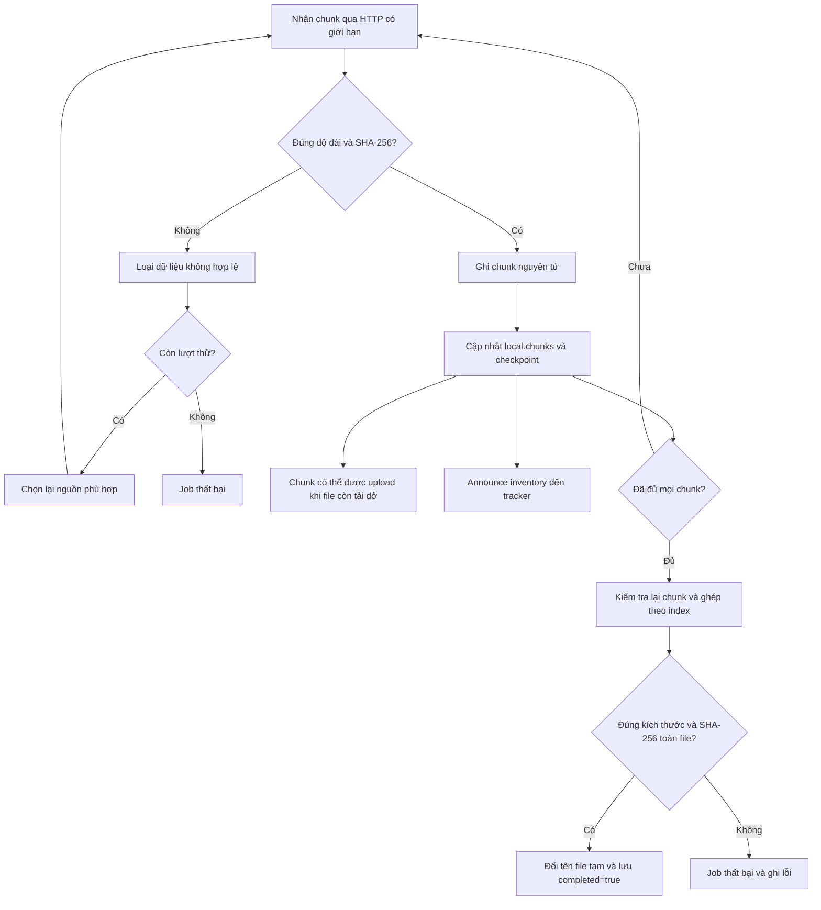

# DS02 Technical architecture

## Nodes and process isolation

`tracker`, `peer-a`, `peer-b`, `peer-c` each run a separate `uvicorn` process in a distinct container. Each peer has a unique Peer ID, internal hostname and private persistent directory. Only Seeder A is mounted to the source `sample_files` directory; B/C never read original files from shared host storage. The system also runs over separately bound localhost TCP ports for tests.

The optional browser demonstration (`python scripts/run_visual.py`) runs a local dashboard on `127.0.0.1:8080`. For each scenario, its controller creates a fresh `runtime/visual-<timestamp>-<uuid>/` directory and starts one tracker plus three independent peer processes on separately allocated loopback ports. Each peer retains its own data directory. Only A's shared directory receives the source, either a selected local file or the automatically generated 4 MiB sample. C obtains its initial replica through the chunk API in scenarios 1, 3 and 4. Scenario 2 starts C while B is still downloading.

The dashboard is a control and observation layer: it provisions the original source for A, starts downloads, injects demo faults and polls authenticated state/event APIs. It does not relay peer chunk transfers, and tracker responsibilities remain metadata and inventories. Per-stack credentials are generated in the backend and are not sent to browser assets or dashboard state. Existing Docker and CLI entry points operate independently.

The browser's native file picker accepts any extension and uploads the original bytes to `POST /api/source?name=...` using `application/octet-stream`. The controller accepts 8 bytes–32 MiB, preserves the original filename and bytes, and rejects control characters, path traversal and reserved Windows names. It stores the input privately under ignored `runtime/visual-inputs/`, then copies it only into each new A shared directory. B/C still obtain their chunks over peer HTTP. Chunk size is `ceil(file_size / 64)`, producing at most 64 chunks without padding or format conversion. The lower size limit leaves enough chunks for source sharing and failure demonstrations.

Peer downloaders accumulate HTTP body segments through EOF before checking a chunk. The read remains bounded to the expected chunk length plus one byte, so a valid large chunk split across transport reads is accepted while oversized responses remain bounded and rejected.

`GET /api/state` includes selected-source metadata for the dashboard lifetime; selection survives repeated scenarios, including all four cases, and resets when the dashboard restarts. `DELETE /api/source` returns to the automatic sample. `GET /api/artifact/peer-b` lets the browser download B's completed file after independent hash verification; C's completed output is also available for scenario 2. This final artifact download is separate from peer-to-peer chunk transport.

## API contract

| Provider | Endpoint | Purpose | Authentication |
|---|---|---|---|
| Tracker | `GET /health` | Liveness | None |
| Tracker | `GET /api/files` | Available file list | None |
| Tracker | `GET /api/files/{id}` | Immutable metadata + live peer inventory | None |
| Tracker | `PUT /api/announce` | Publish metadata and chunk inventory | `X-Tracker-Token` |
| Tracker | `DELETE /api/peers/{id}` | Graceful departure | `X-Tracker-Token` |
| Peer | `GET /health` | Liveness | None |
| Peer | `POST /api/seed` | Split local file and share chunks | `X-Admin-Token` |
| Peer | `GET /api/files` | Inspect local file summaries | `X-Admin-Token` |
| Peer | `GET /api/chunks/{id}/{n}` | Direct peer-to-peer chunk payload | `X-Peer-Token` |
| Peer | `POST /api/downloads` | Background parallel download | `X-Admin-Token` |
| Peer | `GET /api/downloads/{id}` | Download progress, failures, sources | `X-Admin-Token` |
| Peer | `POST /api/debug/corrupt` | Simulate malicious/damaged chunk | `X-Admin-Token` |
| Peer | `POST /api/debug/serving/{boolean}` | Simulate temporarily unreachable source | `X-Admin-Token` |
| Peer | `GET /api/debug/state` | Local chunk inventories, download/serving state | `X-Admin-Token` |
| Peer | `GET /api/debug/events?after=0&file_id=...` | Incremental transfer telemetry; optional file filter | `X-Admin-Token` |
| Peer | `GET /api/debug/active-uploads` | In-flight upload count for fault timing | `X-Admin-Token` |
| Peer | `POST /api/debug/upload-delay/{milliseconds}` | Set demo upload delay, bounded to 0–2000 ms | `X-Admin-Token` |

## Visual demonstration and telemetry

Each peer stores at most 2,048 recent events in memory. An event includes an increasing local `seq`, UNIX timestamp `time`, `kind` and `peer_id`; transfer events include `file_id`, chunk index and source where applicable. `GET /api/debug/events` returns events after a cursor and a `last_seq` cursor. This bounded diagnostic buffer is not a persistent audit log; normal process logs remain under the scenario runtime directory.

The controller collects state and events from all three peers. The browser draws transfer arrows from successful `DOWNLOAD_CHUNK` events and displays inventories, phase changes, failures and verification results. Demo 2 requires an actual B `UPLOAD` event with `completed=false` and C reporting B among its sources. Demo 3 checks both rejection of C's corrupted chunk #1 and successful receipt of that same index from A. Demo 4 waits for an active upload from A, disables serving to trigger HTTP 503, and checks that B retries an affected chunk through C. This is a serving failure; A's process stays alive. The injected serving fault is removed in cleanup.

After each scenario, B's output size and SHA-256 are checked against metadata independently of the transfer status; scenario 2 also verifies C's final hash. Each new scenario replaces the prior stack with a fresh one while retaining the chosen source. The dashboard remains available after completion until Ctrl+C. Shutdown terminates only its owned subprocesses and preserves downloaded files and logs. `python scripts/run_visual.py --check` executes the same four scenarios without the browser, reports their checks and exits with a nonzero status on failure. Add `--file <path>` to check the four scenarios against a selected local file.

## Metadata structure

```json
{
  "file_id": "SHA256-hex-of-original-file",
  "file_name": "sample.bin",
  "file_size": 4194304,
  "chunk_size": 65536,
  "chunk_count": 64,
  "chunk_hashes": ["SHA256-hex-of-chunk-0", "..."],
  "file_hash": "SHA256-hex-of-original-file",
  "tracker_url": "http://tracker:8000"
}
```

This is an illustrative structure; placeholders above are NOT valid real SHA-256 values. Actual metadata is generated automatically by the Seeder. Tracker rejects conflicting metadata for a given file ID.

## Chunk transfer sequence

```mermaid
sequenceDiagram
    participant A as Seeder A
    participant T as Tracker
    participant B as Peer B
    participant C as Peer C
    A->>T: PUT announce(file + chunks 0..N)
    C->>T: GET file metadata + peers
    C->>A: GET chunk 0 (direct bytes)
    A-->>C: chunk bytes
    C->>C: verify SHA256; atomic write
    C->>T: PUT announce(chunks={0})
    B->>T: GET file metadata + availability
    B->>A: GET chunk 2
    B->>C: GET chunk 0 (from incomplete C)
    A-->>B: bytes
    C-->>B: bytes
    B->>B: verify chunks, merge in order
    B->>B: SHA256(final file) == file_hash
```

## Luồng xác minh, checkpoint và phục hồi

### 1. Từ dữ liệu nhận được đến chunk có thể chia sẻ

Trong `PeerNode._fetch_chunk()` của `src/p2psim/peer.py`, một lượt nhận thành công đi qua các bước sau:

1. Đọc phản hồi HTTP đến EOF với giới hạn bằng độ dài chunk dự kiến cộng một byte; từ chối sớm nếu `Content-Length` đã vượt giới hạn.
2. `validate_chunk()` đối chiếu **cả độ dài và SHA-256** với metadata của index đang tải. Dữ liệu không hợp lệ bị loại và chuyển sang cơ chế retry/chọn nguồn khác, không được thêm vào tập chunk hợp lệ.
3. Trong `state_lock`, gọi `atomic_bytes()` để lưu chunk, thêm index vào `local.chunks`, rồi gọi `_persist()` để ghi checkpoint.
4. Ghi sự kiện `DOWNLOAD_CHUNK` và gửi `announce()` để tracker biết inventory mới. HTTP upload của peer có thể phục vụ chunk đã lưu và có trong `local.chunks` mà không đợi `local.completed=true`.

Vì vậy, **xác minh từng chunk là điều kiện để nhận và chia sẻ phần dữ liệu đó; xác minh toàn file là điều kiện để công bố kết quả tải hoàn chỉnh**. Tracker chỉ giữ metadata/inventory. Byte chunk vẫn truyền trực tiếp giữa các peer.



Nếu announce lỗi sau khi checkpoint đã lưu, chunk hợp lệ vẫn tồn tại cục bộ. Lượt tải có thể thử lại và heartbeat định kỳ có thể công bố lại inventory. Trạng thái tracker vì vậy nhất quán cuối cùng với kho chunk, không cập nhật đồng thời tuyệt đối với thao tác ghi đĩa.

### 2. Checkpoint lưu gì và bảo đảm đến đâu?

Mỗi peer lưu dữ liệu dưới thư mục `PEER_DATA_DIR` riêng:

| Đối tượng | Đường dẫn trong thư mục peer | Nội dung |
|---|---|---|
| Chunk | `storage/<file_id>/<index:08d>.part` | Byte của từng chunk; ví dụ index 3 là `00000003.part` |
| Checkpoint | `storage/<file_id>/state.json` | `metadata`, danh sách `chunks` và cờ `completed` |
| File kết quả | `downloads/<file_name>` | File ghép đã qua bước xác minh toàn file |

`atomic_bytes()` và `atomic_json()` trong `common.py` ghi file tạm cùng thư mục, flush/fsync rồi `os.replace()`. Mỗi file được thay thế nguyên tử; **chunk và checkpoint không phải một giao dịch nguyên tử chung**. Nếu tiến trình dừng sau khi lưu chunk nhưng trước khi checkpoint ghi nhận index, lần khởi động sau chỉ nạp những index có trong checkpoint; file chunk chưa được ghi nhận có thể phải tải lại. Thiết kế ưu tiên xác minh được dữ liệu thay vì coi mọi file `.part` tìm thấy là hợp lệ.

### 3. Xác minh toàn file trước khi hoàn tất

Sau khi các worker kết thúc mà không có lỗi, `_run_download()` đọc chunk theo index từ `0` đến `chunk_count - 1`, kiểm tra lại từng chunk và ghi vào `downloads/.<file_id>.partial`. Đồng thời chương trình tính lại SHA-256 toàn file. Chỉ khi kích thước và hash khớp metadata, file tạm mới được thay thế sang tên kết quả, checkpoint ghi `completed=true` và job chuyển sang `completed`. Nhận đủ số lượng chunk chưa đủ để bỏ qua bước xác minh này.

### 4. Khởi động lại và tiếp tục tải

`PeerNode._load_states()` chạy khi tạo peer, đọc các `state.json` và kiểm tra metadata cùng tên thư mục File ID. Với mỗi index được checkpoint khai báo, chương trình kiểm tra phạm vi index, sự tồn tại của file chunk, độ dài và hash thực tế. Chỉ chunk vượt qua các kiểm tra mới được đưa vào `local.chunks`; bản thiếu/hỏng phải được tải lại. Checkpoint không đọc được hoặc sai cấu trúc được ghi log `IGNORE_BAD_STATE` và bỏ qua. Trạng thái hợp lệ được ghi log `RECOVER`.

Sau khi peer bắt đầu chạy, heartbeat công bố lại inventory đã phục hồi. **Chương trình không tự khởi chạy lại job download**: người điều khiển gửi lại `POST /api/downloads` hoặc lệnh CLI download với cùng File ID. Peer tra cứu tracker, đối chiếu metadata và chỉ đưa các index chưa có trong `local.chunks` vào hàng đợi. Nếu toàn bộ chunk được khôi phục, bước ghép vẫn có thể chạy mà không tải lại chunk.

Cờ `completed` khi nạp checkpoint chỉ được giữ nếu checkpoint đã đánh dấu hoàn tất và mọi chunk được xác minh. Khi nhận yêu cầu download, `begin_download()` còn kiểm tra file kết quả có tồn tại và đúng hash trước khi trả `already downloaded`; nếu không, nó tiếp tục luồng ghép/xác minh từ các chunk cục bộ. Không dùng riêng cờ checkpoint làm bằng chứng file kết quả còn đúng.

### 5. Điều kiện tái lập và phạm vi kiểm chứng

- Giữ nguyên thư mục dữ liệu của peer qua restart, dùng cùng File ID và bảo đảm tracker/nguồn còn truy cập được. Không dùng thư mục của peer khác để thay cho truyền dữ liệu qua mạng.
- Mỗi lượt dashboard và mỗi lần chạy `run_local.py` tạo thư mục mới, nên chạy lại một demo mới không phải tiếp tục job cũ. Muốn kiểm chứng resume phải khởi động lại peer với đúng `PEER_DATA_DIR` trước đó.
- Theo dõi `RECOVER`, số chunk đã có, các sự kiện `DOWNLOAD_CHUNK` cho phần thiếu và hash file cuối. Nếu không còn nguồn giữ chunk cần thiết, resume không thể tự tái tạo byte từ mã hash.
- `test_restart_recovers_verified_chunk_state` hiện xác nhận tạo lại `PeerNode` và nạp kho chunk của một lần tải đã hoàn tất. Bài này chưa chứng minh end-to-end thao tác kill tiến trình đang tải rồi restart; cần ghi kết quả riêng nếu thực hiện kịch bản đó.

## Recovery and failure model

- **Crash-stop / transient loss:** 2s connect timeout, 6s request timeout, bounded retries (default 12) across discovered alternative peers; TTL expires silent peers from listing.
- **Byzantine data / transmission corruption:** digest mismatch means reject chunk and try another source. Peer keeps an invalid corrupted chunk marked as advertised (intentional for demo); receivers do not accept it.
- **Restart/recovery:** chunk data and checkpoint JSON persist. At peer startup, every claimed chunk is rehashed and only valid ones are made available. Caller can reissue `/api/downloads` to continue missing chunks.
- **Tracker crash:** existing transfers require tracker lookup for each chunk, so they may pause/fail. On tracker recovery, online peers reannounce every three seconds; restart pending downloads if needed. No replicated tracker in this prototype.
- **Ordering and duplicates:** workers pull unique indexes from local queue; chunk hashes map each index to a unique payload. Atomic writes and checksums give idempotent chunk receipt. No global total order is required for independent immutable chunks.

## Security and non-goals

Three shared credentials keep tracker's write API, peers' transfer API and local control API distinct. Use strong independent secrets when configuring `.env`; an exposed HTTP peer admin API and shared tokens are NOT secure over untrusted Internet links. Restrict networks or add TLS and per-peer cryptographic credentials for a real deployment. Do not allow arbitrary server-side paths: Seeder only reads simple filenames from its own `/data/shared` directory. The prototype intentionally omits NAT traversal, DHT, choking, torrent file compatibility and tit-for-tat.
